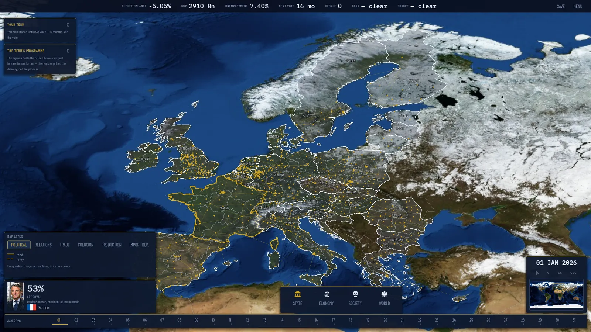
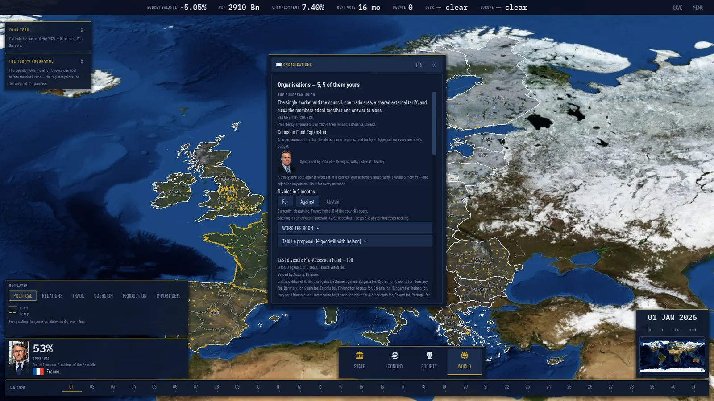
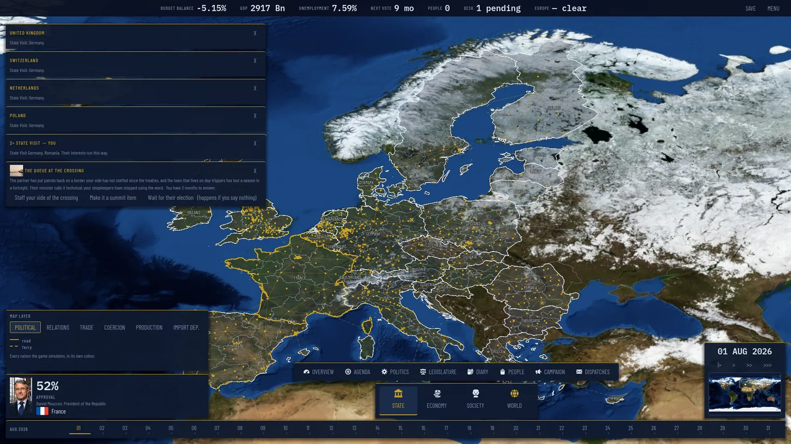

# Nation Simulator

A single-player geopolitics and nation-management game. You are the President of
France: a budget to pass, laws to carry through an assembly that need not agree
with you, a European council to work, events on the desk, and an election at the
end of the term. 29 European nations are simulated; France is the playable one in
this alpha.



| | |
|---|---|
|  |  |

## Run it

1. Install **Godot 4.7.2-stable, standard (non-Mono)** from
   <https://godotengine.org/download/archive/4.7.2-stable/>. The project is pinned
   to 4.7; another version may not open it.
2. Clone this repository.
3. Open the folder in Godot and press Play, or from a terminal at the repository
   root:

   ```bash
   godot --path .
   ```

The first open imports the assets, which takes a minute or so.

## Run the tests

The suite is headless. It needs `bash`, Python 3.10 or later (as `python` or
`python3`) and `godot` on `PATH`, or `GODOT_BIN` set to Godot's path. On
Debian/Ubuntu, Godot also needs `libfontconfig1` (`sudo apt install libfontconfig1`).

```bash
bash tools/run_tests.sh
```

CI runs the same command on every pull request, from a fresh clone, split over
four runners.

## How it is built

- Godot 4.7 with statically typed GDScript. There is no database, and the game
  code has no autoloads.
- Content lives in `data/` as JSON, never in code. Dependencies go one way only:
  `data → sim → ui`. A full ten-year run works headless.
- The design documentation is an Obsidian vault: open the **repository root** as
  the vault and start at [docs/index.md](docs/index.md).
- [AGENTS.md](AGENTS.md) holds the conventions and gotchas for anyone, human or
  AI, changing the code.

## Licence

This repository is licensed in layers, file by file, following the
[REUSE](https://reuse.software) specification. `REUSE.toml` says which licence
covers which file, and the texts are in [LICENSES/](LICENSES/):

| What | Licence |
|---|---|
| Code, tools and tests | [PolyForm Noncommercial 1.0.0](LICENSES/PolyForm-Noncommercial-1.0.0.txt): free to use, change and share for any noncommercial purpose |
| Game content (`data/`), the design vault (`docs/`), and art generated from text alone | [CC BY-NC 4.0](LICENSES/CC-BY-NC-4.0.txt) |
| The 425 portrait files generated from Wikimedia Commons photographs | [CC BY-SA 4.0](LICENSES/CC-BY-SA-4.0.txt), with each source credited in [docs/portrait-attribution.md](docs/portrait-attribution.md) |
| Fonts, `addons/`, the map raster, the Obsidian plugin bundles | their own licences (OFL-1.1, MIT, public domain, MIT/GPL/AGPL), declared in `REUSE.toml` |

Commercial use of the code, content or text-generated art needs the author's
permission. Data sources are credited in [ATTRIBUTION.md](ATTRIBUTION.md).

Every person in the game is fictional. Names and parties are invented, and where a
portrait was grounded on a photograph of a real politician, that photograph is
credited, as its licence requires.

## Contributing

Issues and pull requests are welcome; read [CONTRIBUTING.md](CONTRIBUTING.md)
first. Every contributor signs the [CLA](CLA.md) once, with one comment on their
first pull request.
