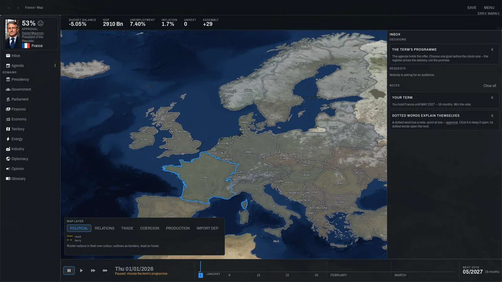
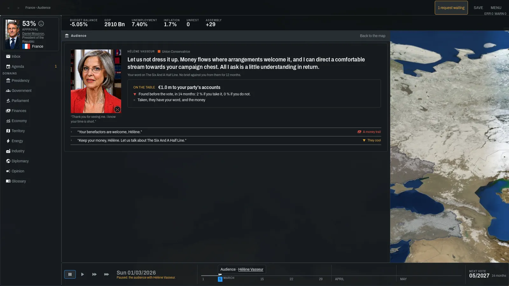
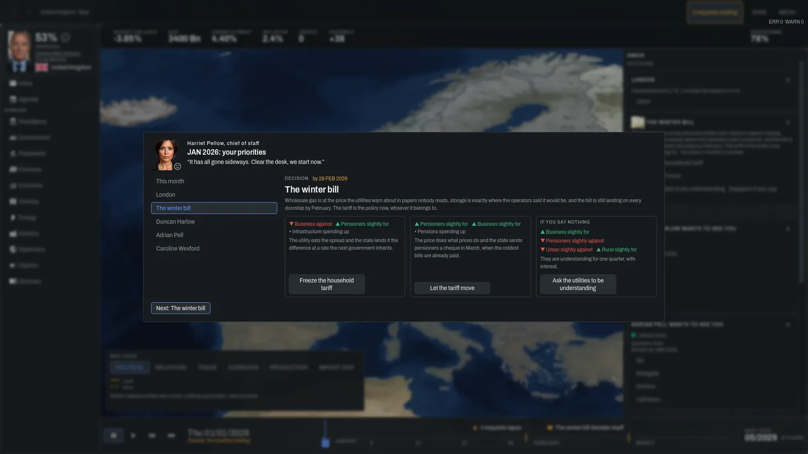
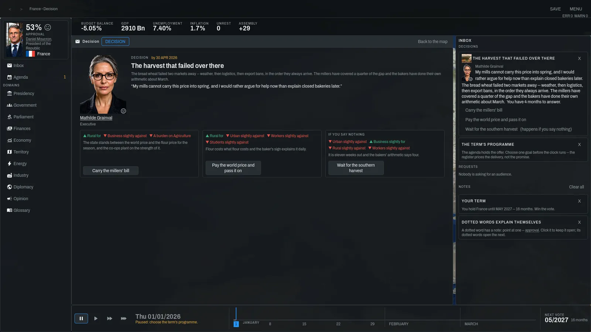

# Nation Simulator

A single-player geopolitics and nation-management game. You lead one of four European
nations (France, Germany, the United Kingdom or Poland) through a term: you write the
budget, carry laws through an assembly that does not have to agree with you, deal with
firms and regions, work the European council, and stand for election at the end. 41
European nations are simulated around you.



It is an alpha. You can play it from source, and there is no packaged release yet. The
interface is being rebuilt one screen at a time, and the pictures here show screens that
have already been redone.

| | |
|---|---|
|  |  |



## What you do

- Spending and taxes are one finance bill. You table it, each party reads it like a law,
  and the assembly votes it at the end of the month. Twenty taxes exist in the game, and a
  tax is introduced or abolished only in the autumn bill.
- 120 laws on 13 shelves go through an assembly of parties with their own discipline,
  rebels and coalition partners. Some laws need a referendum, and some need an amendment.
- Ministers, party leaders, press owners and company chiefs ask to see you. An audience is
  a deal: what they want, what they give, and what each answer costs, with the price of a
  refusal shown before you choose.
- Spending lines split into sectors that move real quantities, such as hospitals or rail.
  You can take a stake in a firm, nationalise it, break it up or privatise it, and
  negotiate the price. Failing plants announce closures, and a regional fund helps the
  region that falls behind.
- You can commission a poll on a bill, or address the nation to sway a vote.
- The European council has treaties, presidencies and vetoes, and its other members have
  agendas of their own.
- A chief of staff briefs you each month, and the month's folder holds the events and
  requests waiting for an answer. A month with nothing urgent brings someone to talk to.
- The election closes the term. Voters weigh how well you ran the country as well as what
  you decided.

The game runs in English, with a French translation under way. It has voiced chiefs of
staff and company chiefs, and music. [CHANGELOG.md](CHANGELOG.md) lists what changed for a
player in each build.

## Run it

1. Install **Godot 4.7.2-stable, standard (non-Mono)** from
   <https://godotengine.org/download/archive/4.7.2-stable/>. The project is pinned
   to 4.7; another version may not open it.
2. Clone this repository.
3. Open the folder in Godot and press Play, or from a terminal at the repository
   root:

   ```bash
   godot --path .
   ```

The first open imports the assets, which takes a minute or so.
New Game asks which of the four nations to lead. Saves from an older build are refused, not
converted.

## Run the tests

The suite is headless. It needs `bash`, Python 3.10 or later (as `python` or
`python3`) and `godot` on `PATH`, or `GODOT_BIN` set to Godot's path. On
Debian/Ubuntu, Godot also needs `libfontconfig1` (`sudo apt install libfontconfig1`).

```bash
bash tools/run_tests.sh
```

CI runs the same command on every pull request, from a fresh clone, split over
four runners.

## How it is built

- Godot 4.7 with statically typed GDScript. There is no database, and the game
  code has no autoloads.
- Content lives in `data/` as JSON, never in code. Dependencies go one way only:
  `data → sim → ui`. A full ten-year run works headless.
- The design documentation is an Obsidian vault: open the **repository root** as
  the vault and start at [docs/index.md](docs/index.md).
- [AGENTS.md](AGENTS.md) holds the conventions and gotchas for anyone, human or
  AI, changing the code.

## Licence

This repository is licensed in layers, file by file, following the
[REUSE](https://reuse.software) specification. `REUSE.toml` says which licence
covers which file, and the texts are in [LICENSES/](LICENSES/):

| What | Licence |
|---|---|
| Code, tools and tests | [PolyForm Noncommercial 1.0.0](LICENSES/PolyForm-Noncommercial-1.0.0.txt): free to use, change and share for any noncommercial purpose |
| Game content (`data/`), the design vault (`docs/`), and art generated from text alone | [CC BY-NC 4.0](LICENSES/CC-BY-NC-4.0.txt) |
| The 700 portrait images (140 people, five expressions each) generated from Wikimedia Commons photographs | [CC BY-SA 4.0](LICENSES/CC-BY-SA-4.0.txt), with each source credited in [docs/portrait-attribution.md](docs/portrait-attribution.md) |
| The voice clips (`assets/audio/voice/`, made with ElevenLabs) | no open licence: [LicenseRef-ElevenLabs-Output](LICENSES/LicenseRef-ElevenLabs-Output.txt), all rights reserved, used under ElevenLabs' terms |
| Fonts, icons, `addons/`, the map raster, the five music tracks, the Obsidian plugin bundles | their own licences (OFL-1.1, Apache-2.0, MIT, CC0, public domain, MIT/GPL/AGPL), declared in `REUSE.toml` |

Commercial use of the code, content or text-generated art needs the author's
permission. Data sources are credited in [ATTRIBUTION.md](ATTRIBUTION.md).

The screenshots under `docs/screenshots/` show the game's own portraits, so the portrait
credits above apply to them too.

Every person in the game is fictional. Names and parties are invented, and where a
portrait was grounded on a photograph of a real politician, that photograph is
credited, as its licence requires.

## Contributing

Issues and pull requests are welcome; read [CONTRIBUTING.md](CONTRIBUTING.md)
first. Every contributor signs the [CLA](CLA.md) once, with one comment on their
first pull request.
