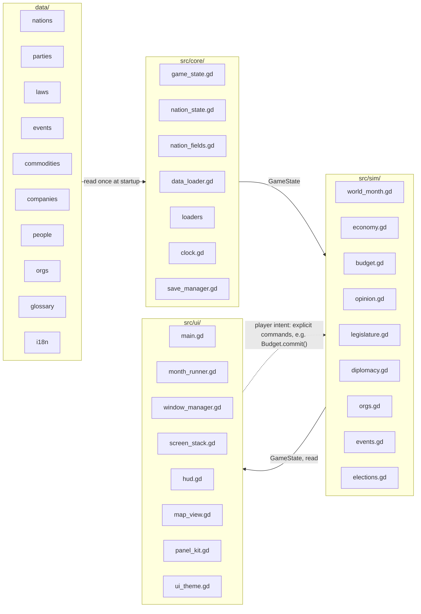

# Data Architecture

How content is stored, how a game in progress is stored, and why there is no database.

## The two kinds of data

The central split, and the reason this document exists:

| | Static / design-time | Live / runtime |
|---|---|---|
| **What** | Nation definitions, party definitions, law templates, political system templates, company definitions, map geometry | The current game: date, treasury, this term's approval, who holds which seats, which laws have passed |
| **Changes when** | A designer edits a file | Every simulated month |
| **Lives in** | `data/`, committed to git | Memory, serialised to a save file |
| **Format** | JSON, hand-editable | JSON save file |
| **Authority** | The repository | The player's save |

Static data is **read once at startup and never mutated**. When the simulation raises France's unemployment, it writes to live state; France's data file still says what unemployment was at game start. This is what makes a save reloadable and a data edit safe.

## Static data

### Layout

```
data/
├── nations/           one file per nation — FRA.json, DEU.json, …
├── parties/           one file per nation's party system
├── people/            one file per nation — every named individual (U6b)
├── laws/              law templates, grouped by theme (S7)
├── political-systems/ institutional templates (V1.2b)
├── scenarios/         authored starting states (V1.2e)
├── diplomatic-actions/ the player's foreign-policy verbs (V1.3a)
├── companies/         fictional firms, playable nations only (V1.4a)
├── company-actions/   the player's verbs pointed at a firm (V1.4a)
├── outlets/           the press, playable nations only (V1.5d)
├── investment-actions/ sector programmes (V1.6e)
├── project-actions/   infrastructure projects (V1.6f)
├── campaign-actions/  the run-up's efforts (V1.7a)
├── pledges/           binding promises (V1.7b)
├── events/            occasions, choices and deadlines (V1.8)
├── regions/           one file per nation — regions and the cities under them (V2.2a)
├── geo/               europe.geojson — borders from Natural Earth
│                      regions.geojson — NUTS regions from GISCO (V2.2a)
└── eu_parliament.json     EU membership, EP seats, EP election schedule (S6)
```

> [!note] `policy_defaults.json` existed from S4 to V1.1d and is gone
> Starting tax rates and spending split were one file shared by every nation,
> because only the player's nation had a budget at MVP. Its own `_note` said
> that was temporary; V1.2a, the session that made a second nation
> playable, was where it came due. Each nation's `fiscal` block now carries its
> own `tax_rates_pct`, `spending_pct_gdp` and `other_spending_pct_gdp` — see the
> schema below. See [[economy-model]] for the sourcing.

One file per entity, named by ISO 3166-1 alpha-3 where a nation is involved. Small files mean readable git diffs and no merge conflicts between unrelated content edits.

### Why JSON, not Godot `.tres` Resources

Godot's native Resource format is the engine-idiomatic choice and was seriously considered. JSON wins on three points that matter more here:

1. **Diffs.** `.tres` carries type metadata and generated IDs that churn on save. JSON diffs show what actually changed.
2. **Editability outside the engine.** Content can be edited, scripted, and bulk-generated — which is exactly what the import script does — without opening Godot.
3. **No engine lock-in on content.** If the simulation layer is ever ported, the content comes along unchanged.

The cost is losing the inspector's type checking. That is bought back by the validator described below, which is more thorough than the inspector anyway.

### Nation schema

As implemented at S1. Fields owned by later sessions — leader (S2),
`system` (V1) — are added by the session whose model reads them, not stubbed in ahead
of time.

> [!note] `voter_blocs` was pencilled in here for S5 and still has not happened
> S5 read the field and decided it was not content. The trigger written down at
> the time was "a second playable nation" — that trigger fired at V1.2a,
> and the call was re-examined, not skipped: bloc weights stayed in
> `src/sim/opinion_constants.gd` as one global table. There is still no source
> for per-nation salience, and a `tools/balance_probe.gd` run comparing France
> and Germany under an identical relative budget found the two already diverge
> sharply — Germany's government lost its majority by month 38 where France's
> held one for the whole fourteen-year run — on institutions and party rosters
> alone, with the bloc table untouched. Full argument and the new trigger:
> [[opinion-model]] and [[declined]].

```json
{
  "id": "FRA",
  "name": "France",
  "geo_id": "FRA",
  "capital": "Paris",
  "playable": true,

  "leader": {
    "name": "Daniel Moucron",
    "title": "President of the Republic",
    "party": "renouveau_civique"
  },

  "government": {
    "legislative": {
      "chamber": "Assemblée nationale",
      "assembly_seats": 577,
      "term_years": 5,
      "election": {
        "_source": "authored",
        "system": "two_round",
        "next": { "year": 2029, "month": 6 },
        "threshold_pct": 0.0
      }
    },
    "system": "semi_presidential_republic",
    "head_of_state": {
      "kind": "executive_president",
      "title": "President of the Republic",
      "name": "Daniel Moucron"
    },
    "term_limit": 2,
    "executive": {
      "_source": "authored",
      "title": "President of the Republic",
      "term_years": 5,
      "next": { "year": 2027, "month": 5 }
    },
    "formation": {
      "_source": "authored",
      "method": "presidential_appointment",
      "censure": "absolute_members",
      "head_of_government_title": "Prime Minister",
      "head_of_government_name": "Cécile Aumont"
    },
    "eu": { "member": true, "ep_seats": 81 },
    "neighbours": ["BEL", "CHE", "DEU", "ESP", "ITA", "LUX"]
  },

  "fiscal": {
    "_source": "authored",
    "_note": "General government, IMF/OECD estimates, rounded. France is the V1.2a starting-policy anchor -- see FRA.json's own note.",
    "debt_to_gdp_pct": 116.0,
    "tax_revenue_pct_gdp": 46.1,
    "tax_rates_pct": { "income": 20.0, "corporate": 25.0, "vat": 20.0 },
    "spending_pct_gdp": {
      "health": 11.0, "education": 5.5, "defence": 2.0,
      "pensions": 14.5, "infrastructure": 3.5
    },
    "other_spending_pct_gdp": 12.0
  },

  "imported": {
    "_source": "worldbank",
    "_year": 2024,
    "_usd_eur": 0.92,
    "population": 68600000,
    "gdp_eur_bn": 2910.0,
    "unemployment_pct": 7.4,
    "sectors": {
      "agriculture": 0.015,
      "industry": 0.192,
      "services": 0.793
    }
  }
}
```

Three sectors, not four — no open dataset splits energy out of industry. If S4's
economy model wants an energy lever, it splits industry as a hand-tuned constant at
that point, against a concrete model rather than a placeholder.

`neighbours` joined at V1.3a and is in that same authored-but-real
class: which nations share a land border is a fact, not a tuning number, and it
is one of only two inputs the relations derivation has. Required and possibly
empty — GBR's list is empty and that is correct, so an absent key would be
indistinguishable from a nation that borders nobody. Only roster members are
listed; `data_loader.gd` fails at startup if a border is not mutual, because the
symmetric pair key would otherwise rest on an asymmetric input. It gained a
second reader at V1.3b -- the trade weight's border bonus -- which is
also why it is copied onto `NationState` rather than looked up through the loader:
`Economy.tick_month()` has no loader argument and twenty-eight call sites that
would all have had to grow one. See [[diplomacy-model]] and [[trade-model]].

`debt_to_gdp_pct` and `tax_revenue_pct_gdp` sit in their own `fiscal` object because
they are **authored, but real** — same class as `assembly_seats`, not the same class
as a party name. World Bank's central-government indicators are null or wrong-scope
for this purpose; see [[data-sources]] for the specifics. They do not refresh on
re-import.

`tax_rates_pct`, `spending_pct_gdp` and `other_spending_pct_gdp` joined the same
object at V1.2a, replacing the one shared `policy_defaults.json`
above. Same class again: France's own numbers are the unchanged anchor, VAT on
the other nine is each one's own sourced statutory rate, income and corporate
are France's scaled by OECD Revenue Statistics tax-to-GDP shares (headline
combined rates directly for Switzerland and Luxembourg, where scaling by
revenue share would have amplified their profit-shifting-inflated corporate
base into an implausible number), and the five spending lines plus
`other_spending_pct_gdp` are France's split scaled by general government
expenditure. Every nation's `_note` says which. `GameState._build_nation()`
reads these instead of a loader-wide defaults argument, and
`Budget._erosion()`'s reference rate is `ns.start_tax_rates_pct` — the nation's
own starting rates, not a shared constant — so every nation, not only France,
begins exactly on its own erosion reference.

> [!note] `leader.party` and the `government` sub-blocks
> `leader.party` resolves to a party id in that nation's own `data/parties/*.json`
> — validated cross-file, the same way `geo_id` is checked against the map.
> Everything under `government` is the same class as `fiscal`: **authored, but
> real**, checked against a source at the session that added it and never
> touched by `tools/import_data.py`. Full argument, every date's source, and
> what each real electoral system reduces to is [[electoral-systems]].
>
> `legislative` and `eu` arrived at S6; `formation` and `executive`
> at [[v1|V1.1a]], which also split the old flat `government.election` into
> `government.legislative.election`. **`executive` is optional and present only
> where the head of government is elected separately from the assembly** — of
> the ten, only France. Absent means the executive comes out of the chamber and
> its term is the legislative term. The argument for that shape, and for
> `formation.method` being dispatched rather than branched on, is
> [[government-model]].
>
> `system`, `head_of_state` and `term_limit` arrived at V1.2b.
> `system` names a `data/political-systems/*.json` file, which constrains —
> not defaults — `formation.method`/`formation.censure`/
> `legislative.dissolution.rule` to the set that template allows.
> `head_of_state` is required for all ten; only `elected_president` carries its
> own `term_years`/`next`, the same optional-but-complete shape `executive`
> already uses. `term_limit` is `0` unless the nation's template permits one —
> only France's does. Full argument: [[political-systems]].
>
> `government.amendment.rule` arrived at V1.2c, constrained the
> same way by the template's own `allowed_amendment_rules` — a sixth
> dispatch-on-a-data-string field, not a new pattern. Unlike every field
> above, it is not fixed for the run: a constitutional amendment can rewrite
> it (entrenchment or loosening), which is why it lives on `NationState`,
> copied at new-game, rather than being read straight off `Nation` on demand.
> Full argument, including the measured finding that Germany's real
> `two_thirds` is unreachable: [[amendment-model]].
>
> `data/parties/*.json` gained `leader_name`, `discipline` and
> `excluded_partners` in the same block. `excluded_partners` is validated
> against that nation's own roster, so a cordon naming a party that does not
> exist is a startup error rather than a silently empty exclusion.

### Region schema

One file per nation, and **unlike `companies/` and `outlets/` an absent file is an
error**: [[v2]] section 5 makes *national = Σ regions* the economic spine, so a nation
with no regions is one the rest of that tier cannot describe. Wholly generated by
`tools/import_data.py` — every field is dataset-derived, so a re-import overwrites the
file rather than merging into it, and the re-import safety rule below has nothing to
protect here yet. See [[geography-model]].

```json
{
  "_source": "Eurostat demo_r_pjangrp3 NUTS 1 (2022); GISCO NUTS_RG_10M_2021; GeoNames cities15000",
  "_year": 2022,
  "regions": [
    { "id": "FRJ", "name": "Occitanie", "share": 0.090673,
      "cities": [
        { "id": "FRJ_toulouse", "name": "Toulouse", "share": 0.084128,
          "lonlat": [1.4442, 43.6045] }
      ] }
  ]
}
```

A region's `share` is of the **nation's population**; a city's is of **its own
region**. Both sums are at most 1.0 and the remainder is the unnamed residual, which
is [[companies-model|V1.4a]]'s partition at two levels — and neither residual is
stored, because `1.0 − Σ` cannot drift from the thing it is the remainder of. Ids are
NUTS codes and NUTS code plus slug, so both are globally unique and safe to read bare
off a firm's `city`.

**The NUTS level is nowhere in the file**, deliberately: France is imported at NUTS 1
and Italy at NUTS 2, the reasons are in [[geography-model]] section 2, and `src/` never
learns a level exists. `tests/test_geography.gd` fails if a region file grows a
top-level key beyond `_source`, `_year`, `_note` and `regions`.

### Unit conventions

| Kind | Convention | Example |
|---|---|---|
| Money | suffix `_eur_bn`, float, EUR billions | `gdp_eur_bn: 2910.0` |
| Population | bare integer, persons | `population: 68600000` |
| Rate | suffix `_pct`, range 0–100 | `unemployment_pct: 7.4` |
| Share | no suffix, range 0–1, group sums to 1.0 | `services: 0.793` |

Everything is EUR, including nations that don't use it. The MVP has one playable
nation and one budget; a `currency` field has no reader until V1.3 trade, if ever.

### The re-import safety rule

> [!important] The import script writes exactly one thing
> `tools/import_data.py` replaces the top-level `imported` object wholesale on every
> run. Every other key in the file — including `fiscal`, which is also real-world
> data — is hand-authored and the script never reads or writes it. It also never
> creates a nation file: if `data/nations/<ID>.json` doesn't exist, the script errors
> rather than inventing one.

A dedicated top-level key the script owns entirely is a structural boundary, not just
a marker to grep for. The validator enforces the other direction — no key inside
`imported` outside the known list — so an authored value can't drift into the block
that gets overwritten.

Raw datasets live in `sources/`, which is **gitignored** — so a `sources/README.md` could never be committed there. Download instructions live in [[data-sources]] instead. Shapefiles and multi-megabyte CSVs never enter the repository and never ship.

Full source and licence detail: [[data-sources]].

### Validation

Validation lives in `src/core/` (`nation.gd`, `data_loader.gd`), not in `tools/` —
`tools/` is not shipped, and validation must run every time the game starts, not just
at import time. It checks:

- Required fields present, correct type.
- Numeric fields within sane ranges — no negative populations, no debt ratios of 40,000.
- Referential integrity — every `geo_id` resolves to a feature in `europe.geojson`, every party's nation exists, every `system` names a real file in `data/political-systems/` (V1.2b), every constitutional amendment's `effects.institutional` is legal under every template named in its own `systems` list (V1.2c, [[amendment-model]]), and every scenario names a *playable* nation, real parties, and real voter blocs (V1.2e, [[scenario-model]]).
- **What a scenario produces, not what it declares.** A scenario's `seat_share` is a partial override merged over the party file's own shares, so the fragment is not required to sum to anything — the check is that the *merged roster* still sums to 1.0, the same invariant `data/parties/*.json` is held to. It is the one check in the loader that passes every per-file test and fails only cross-file, which is why scenario validation is split between `scenario.gd` (range and shape) and `data_loader.gd` (everything needing the nation's roster).
- Domain invariants — party seat shares per nation sum to 100%, sector shares sum to 1.0.
- **Coherence of a SET, which no per-entry check can see.** `data/project-actions/`
  refuses two entries defining one project and an `abandon` naming a project nothing
  starts; `data/events/` refuses two events with the same subject AND the same gate,
  because two crises that can only ever fire in the same months are one event authored
  twice and the second fires only where the first did not (V1.8,
  [[events-model]]).

It runs unconditionally at startup and fails loudly with the offending file and field. This is the cheapest bug-catching in the project: content errors are the most common kind of error in a data-driven game, and they are trivially detectable.

## Live state

### Shape

A single `GameState` object holding plain data, built at new-game time by copying starting values out of the static data. Built in S4, the first session that had anything to mutate.

```
GameState                        src/core/game_state.gd
├── save_version
├── year, month                  mirrored from the Clock each monthly tick
├── player_nation_id
├── nations{}                    String id -> NationState
├── relations{}                  sorted pair key -> float in 0-100 (V1.3a)
├── agreements{}                 sorted pair key -> the agreed terms (V1.3b)
├── history[]                    dated monthly snapshots, for charts
├── recent_effects[]             what the last few commands moved (U4)
└── errors[]                     problems found while building the state

NationState                      src/core/nation_state.gd
├── economy    sector_output{}, gdp, potential_gdp, trend, growth,
│              unemployment, structural_unemployment, population
├── policy     has_budget, tax_rates_pct{}, spending_pct_gdp{}, the starting
│              values of both, other_spending_pct_gdp, other_revenue_pct_gdp
├── fiscal     revenue_pct_gdp{}, totals, debt_service, deficit, debt_eur_bn,
│              the starting deficit the opinion model measures against
├── opinion    bloc_approval{}, overall_approval_pct, issue_salience{}
├── identity   eu_member, neighbours[] -- static facts copied from Nation, read
│              by the trade weight (V1.3b)
├── impulses   demand_impulse, potential_shift, external_impulse,
│              trade_baseline_by_partner{} (V1.3b, replacing a scalar)
├── elections  assembly_seats, term_months, months_in_term, next_election_year/
│              _month, next_ep_election_year/_month, terms_served,
│              incumbent_party_id, seats_by_party{}, last_election{},
│              last_ep_election{}, in_government   (S6)
├── government formation_method, censure_rule, coalition_party_ids[],
│              coalition_seats, coalition_position{}, pm_party_id/_name,
│              is_cohabitation, is_minority, force_cooldown_months,
│              censure_barred_party_ids[], governments_fallen (V1.1a)
├── discipline party_discipline{}  String party id -> live discipline
│                                  (V1.1b, [[discipline-model]])
├── dissolution dissolution_rule, _lockout_months, _notice_months,
│               _lockout_remaining, dissolution_pending, dissolutions_called,
│               last_dissolution{}   (V1.1c, [[dissolution-model]])
├── cabinet    cabinet{}, cabinet_effectiveness{}, cabinet_entitlement{},
│              reshuffles_called, resignations_count, last_resignation{}
│                                  (V1.1d, [[cabinet-model]])
├── legislature law_* accumulators, passed_law_ids{}, law_cooldown_months{},
│              last_law_result{}   (S7)
├── political system_id, head_of_state_*, lose_condition, term_limit
│              (V1.2b, [[political-systems]]) -- system_id,
│              lose_condition and head_of_state_* become mutable at runtime
│              from V1.2d on, a system transition being the first
│              thing that writes them ([[transition-model]])
├── amendment  amendment_rule -- mutable at runtime, unlike its V1.2b
│              siblings above   (V1.2c, [[amendment-model]])
└── transition permits_system_change   (V1.2d, [[transition-model]])
```

Later sessions add their own fields the same way the nation schema is grown — S6 election state, V1.1a's government, V1.1b's discipline, V1.1c's dissolution, V1.1d's cabinet. The clock stays authoritative for the date; folding it in is S9's call, when save/load needs one place to read it from.

`NationState.duplicate_state()` and `GameState.duplicate_state()` deep-copy the whole thing. That is not a convenience: the budget projection runs the real simulation forward on a copy, which is what makes the projected path identical to what subsequently happens rather than merely close. Every Dictionary field must be duplicated, not shared.

Both are hand-written field lists, so a field added to the class and forgotten in the copy fails silently and nastily — the projection ends up sharing a Dictionary with the live game. `tests/test_state_copy.gd` (S5) enumerates the fields off the object rather than listing them, and checks both failure modes: not copied at all, and copied by reference. It needs no edit when a session adds a field, which is the point.

**V5.0a: NationState's half is no longer hand-written.** `duplicate_state()`, `to_dict()` and `from_dict()` each walk one table, `src/core/nation_fields.gd`: a row per field carrying how it copies, how it is read back, its default and whether its absence reads correctly for an older save (the bump rule below, as a column). `tests/test_nation_fields.gd` fails when a `var` has no row, round-trips every field from a sentinel, checks a loaded state shares nothing with its payload, and pins the must-bump set against `SAVE_VERSION`. `GameState`'s triple is still hand-written: its registers each carry a bespoke per-entry schema the table's readers do not cover.

Systems in `src/sim/` read and write `GameState`. Nothing else does. The UI reads it and never writes it — player intent goes back as explicit commands, of which `Budget.commit()` is the first. This is the one-way dependency rule from [[engine-decision]].

### Persistence

Live state is serialised to a JSON save file. The whole `GameState` object, written in one go, read in one go.

> [!warning] `to_dict()` hands out the LIVE dictionaries, not copies
> Found at V1.4a, in a test that had to be rewritten around it.
> `GameState.to_dict()` and `NationState.to_dict()` build a fresh **outer**
> dictionary and put the live inner ones straight into it, and `from_dict()`
> assigns them straight back out — its own header says it expects freshly parsed
> JSON, where every container is already unshared. That is correct for the real
> save path, which goes through `JSON.stringify`/`JSON.parse_string`.
>
> It is a trap for anything that builds **two** states from two `to_dict()` calls
> and then ticks both: they share one register, and the second tick advances a
> state the first already moved. Round-trip through JSON when a test or a tool
> needs two independent copies — or use `duplicate_state()`, which does deep-copy
> and is what `Budget.project()` uses.
>
> **V5.0a closed the NationState half:** its `from_dict()` now REBUILDS every
> register through the field table's readers, so two NationStates loaded from
> one payload share nothing. `GameState.from_dict()` is unchanged.

**`save_version` is written from the very first save.** It costs one line now. Retrofitting it after there are saves in the wild means guessing at a format from its contents. On load: matching version proceeds, older version runs a migration if one exists, unknown or newer version fails with a clear message rather than half-loading.

**It is at 9, and no migration has ever been written.** Version 1 → 2 at V1.1a, because government formation split the executive's term from the assembly's and added the coalition fields. Version 2 → 3 at V1.1b, because [[discipline-model|party discipline]] became live state and a save without a `party_discipline` table would score every coalition bonus and every censure vote against the authored figure rather than the eroded one. Version 3 → 4 at V1.1c, for [[dissolution-model|dissolution]]'s six new fields. Version 4 → 5 at V1.1d, for [[cabinet-model|cabinet]]'s six. Version 5 → 6 at V1.2b, for [[political-systems|the political-system fields]] (`system_id`, head-of-state, `lose_condition`, `term_limit`). Version 6 → 7 at V1.2c, for [[amendment-model|`amendment_rule`]] — mutable at runtime, unlike its V1.2b siblings, since an amendment may entrench its own threshold. Version 7 → 8 at V1.2d, for [[transition-model|`permits_system_change`]] — and the point where `system_id`/`lose_condition`/head-of-state stop being fixed for the whole run, a system transition being the first thing in this model that writes any of them after new-game. Every bump is refused outright rather than restored with a field silently missing — a half-understood political state is worse than a clear refusal, and `tests/test_save_load.gd` names each superseded version as a case of its own because those are the versions an actual player has on disk.

> [!note] V1.2e added a runtime-readable field and did **not** bump
> `GameState.scenario_id` is the first addition since V1.2b to stop at 8. The
> rule this list follows is not "a new field bumps" but "a missing field would
> be read as something *wrong*" — and a version-8 save has no `scenario_id`
> because it was a standard start, which is exactly what `""` means. The
> scenario's effects ride in the ordinary fields either way, since a scenario
> applies once at new-game and mutates nothing after. Same call V1.2a
> made and held. See [[scenario-model]].

Version 8 → 9 at V1.3a, and it is the clearest illustration of that
same rule cutting the other way. `GameState.relations` is the first live state
that is neither per-nation nor global; a version-8 save carries no `relations`
key, every pair then resolves to `0.0`, and `0.0` is the **worst possible**
relations rather than a neutral default — a loaded save would be ten nations who
all hate each other. `NationState.law_bloc_offset` was renamed to `bloc_offset`
in the same bump, which is the only window in which renaming a serialised field
is free: an unrenamed key would be dropped on load, quietly discarding every
accumulated approval offset a played game had earned. `tests/test_save_load.gd`
checks the premise directly rather than asserting it in prose. See
[[diplomacy-model]].

**9 -> 10 at V1.3b**, and the interesting part is which of three
candidate fields earned it -- all three were checked in `tests/test_save_load.gd`
rather than argued. `agreements` did **not**: an absent register reads as `{}`,
which is exactly right for a version-9 save, and that is `scenario_id`'s case
again. `trade_baseline_by_partner` did not either, quite: it fails *soft*, because
`Trade.external_impulse()` re-bases a missing partner to its current growth, so an
absent dictionary silently re-zeroes the channel at the moment of loading rather
than producing nonsense. What earned it is `NationState.eu_member` and
`.neighbours` -- absent, every nation loads landlocked and outside the EU, both
gravity bonuses vanish, and the trade weight silently collapses back to the
GDP-only vector V1.3b replaced. A reloaded game would run a **different model**
from the one that saved it. See [[trade-model]].

Saves are JSON rather than binary, deliberately. A save you can open in a text editor is a save you can debug, and during development that is worth far more than file size or load speed. The switch to a binary format is a two-line change if a save ever gets large or slow enough to matter — measured, not assumed.

## Why there is no database

No SQLite. No embedded key-value store. Nothing beyond files.

This is not "keep it simple" as a slogan. The concrete case:

**Scale.** The MVP is ten nations, roughly sixty parties, fifteen law templates, and sixty voter blocs. Say a few hundred entities carrying a few thousand numbers — well under a megabyte in memory. At the outer [[someday]] scale of all ~195 nations with regional breakdown, it is a few thousand entities and single-digit megabytes. Entirely resident, comfortably.

**Query shape.** Every lookup this game performs is either a direct key lookup ("give me France") or a scan over an array of ten to a few thousand items ("every nation with debt over 90%"). A dictionary handles the first. A `filter()` handles the second, in microseconds. There is no join, no index, no aggregation over a large table, no concurrent access. A query engine would have nothing to do.

**The actual cost.** A database imposes a schema. This game's schema changes constantly during development — every new mechanic adds fields to nations, laws, or state. With JSON, adding a field is adding a field. With a database, it is a migration, every time, forever. That directly attacks the property this architecture exists to protect: *content stays easy to add and tweak*.

**Single-player.** No concurrent writers, no transactions, no crash-consistency requirement beyond "write the save file atomically". The problems a database solves are not present.

### What would change the answer

Stated in advance, so the decision can be revisited on evidence rather than on feeling:

- A **profiled** load time or tick time where data access, not simulation arithmetic, is the bottleneck.
- A real need to query historical state across many simulated years without holding it all in memory — a deep analytics or replay feature.
- Save files large enough that full serialisation causes a visible stall, where incremental writes would fix it.

**Not** on that list: the entity count growing. More nations is more array elements, and the array was never the problem.

---

> [!note] V1.1e adds two blocks to `government` and one to `imported`
> `government.upper` is **optional** — Luxembourg's Chambre des Députés is unicameral,
> and an absent block is the legal authored state, which is `government.executive`'s
> own shape. It carries `chamber`, `seats`, and the two verdict rows `ordinary` and
> `amendment`, because the real distinction is between CLASSES OF BILL and not between
> second chambers. `government.judicial` is **required for all ten**: every state has
> some answer to whether its courts may strike a statute down, and three of the ten
> answer `none` for three different doctrines, so an absent block would make a silence
> indistinguishable from Britain's parliamentary sovereignty.
>
> `imported.institutions` holds one key and **no provenance at all**, which is the
> point rather than an omission: every other block under `imported` carries provenance
> because it is read at a year or over a window the file's own `_year` does not
> describe, and rule of law is complete for all ten at `_year` on the standard window.
> See [[judiciary-model]] §1 and [[upper-house-model]] §7.

## The layers, drawn

The three rules of [[engine-decision]] as a picture with the real module names. The diagram is generated and checked (`tools/vault_diagrams.py`, run by `tools/check_vault.py`): it fails when a drawn module is renamed or deleted, and when a file under `src/sim` or `src/core` starts loading `src/ui`, which is rule 2. The tick order that runs inside the sim layer is on [[tick-order]].

<!-- vault-diagram:layers begin (generated by tools/vault_diagrams.py --write; do not edit) -->


`data/` is content, read once and never mutated; `src/core/` is state, clock, save and the loaders; `src/sim/` is one file per system with no UI knowledge; `src/ui/` is scenes and panels, read-only over state. Dependencies point one way: a file in `src/sim` or `src/core` never loads anything under `src/ui` and never reaches the scene tree. `python tools/vault_diagrams.py` fails on a violation, and on a module drawn above that no longer exists.
<!-- vault-diagram:layers end -->

Related: [[index]] · [[engine-decision]] · [[data-sources]] · [[fictionalization]] · [[scope]] · [[political-systems]] · [[amendment-model]] · [[scenario-model]]
