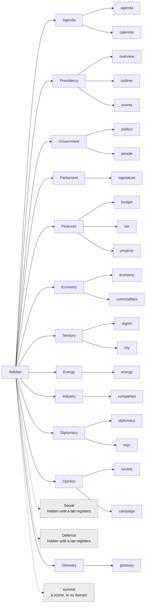

# The shell

What the player sees around the map since V5.1-c: a map at the back, a workspace docked left under a domain sidebar, a HUD of chrome, and a screen stack above them. This page is the picture; the prose, with code lines, is [[panel-system]] section 25, and [[tooling]] covers the dev console that sits above it all.

## The layers

The canvas below is hand-drawn, because the layering is spatial. A script checks that every file and path it names is still on disk (`python tools/check_vault.py`), so it cannot keep drawing a file a refactor deleted, which is how [[panel-system]] came to describe a shell that had gone.

![[shell.canvas]]

Two design notes owned by the Gameplay session are linked from the canvas and not edited here: [[glossary-tooltips]] (what a term underline does) and [[decision-surfaces]] (every surface that asks the player something, measured).

## The domains

Which tab sits under which sidebar heading is `TABLE` in `src/ui/domains.gd`. This diagram is generated from it and checked: every tab drawn must be a window `main.gd` registers, and a change to the table that is not redrawn fails the vault check. Dashed boxes are not shown to the player yet: a domain with no tab is hidden until V5.3 or V6 registers one, and a scene owns the screen outside any domain. To redraw after editing the table, run `python tools/vault_diagrams.py --write`.

<!-- vault-diagram:domains begin (generated by tools/vault_diagrams.py --write; do not edit) -->

<!-- vault-diagram:domains end -->

Related: [[index]] · [[panel-system]] · [[data-architecture]] · [[v5]]
