# The month's tick order

Every game month runs the same systems in the same order, from one place: `WorldMonth` in `src/sim/world_month.gd`. The game, the balance harnesses and the probes all call it, so an order cannot exist in two copies (the reason it was extracted: harnesses that carried their own copy omitted machines and measured a world the game never runs, see [[history]] V4.4 and AGENTS.md "Green is not measured").

The order is load-bearing, not a convenience. The comments at each step in `world_month.gd` say why that step sits where it does (Access before Economy, Commodities after Economy and before Opinion, Events after the four registers it reads). When a system is added, the place it goes in this list is a design decision: [[economy-model]], [[opinion-model]] and [[events-model]] record several. The month is also a cursor, so the UI can spread it over frames without changing a byte of the result (V5.1-0a); see [[test-suite-model]] for how the tests hold that.

The diagram below is generated from `STEPS` and checked on every `python tools/check_vault.py`; to update it after adding a step, run `python tools/vault_diagrams.py --write`.

<!-- vault-diagram:tick-order begin (generated by tools/vault_diagrams.py --write; do not edit) -->
The month runs **32 steps** in this order, once per game month (`STEPS` in [`src/sim/world_month.gd`](../src/sim/world_month.gd), held to the real calls by `tests/test_world_month.gd`). Read each row left to right, then the next row. Colour and the second line of each box give the domain.

Steps 1 to 8:

```mermaid
flowchart LR
  s1["1 Access<br/>Economy"]:::g0
  s2["2 Energy<br/>Economy"]:::g0
  s3["3 Economy<br/>Economy"]:::g0
  s4["4 Commodities<br/>Economy"]:::g0
  s5["5 Budget<br/>Economy"]:::g0
  s6["6 Orgs<br/>Opinion and agenda"]:::g1
  s7["7 Inflation<br/>Economy"]:::g0
  s8["8 Media<br/>Opinion and agenda"]:::g1
  s1 --> s2 --> s3 --> s4 --> s5 --> s6 --> s7 --> s8
  classDef g0 fill:#cfe3f7,stroke:#555,color:#1a1a1a
  classDef g1 fill:#f6dcc2,stroke:#555,color:#1a1a1a
  classDef g2 fill:#dccff0,stroke:#555,color:#1a1a1a
  classDef g3 fill:#cdebd3,stroke:#555,color:#1a1a1a
  classDef g4 fill:#f3e7b5,stroke:#555,color:#1a1a1a
  classDef g5 fill:#f2cfd3,stroke:#555,color:#1a1a1a
```

Steps 9 to 16:

```mermaid
flowchart LR
  s9["9 Programme<br/>Opinion and agenda"]:::g1
  s10["10 Opinion<br/>Opinion and agenda"]:::g1
  s11["11 History<br/>Opinion and agenda"]:::g1
  s12["12 Calendar<br/>Opinion and agenda"]:::g1
  s13["13 Discipline<br/>Assembly"]:::g2
  s14["14 Legislature<br/>Assembly"]:::g2
  s15["15 Statute<br/>Assembly"]:::g2
  s16["16 Dissolution<br/>Assembly"]:::g2
  s9 --> s10 --> s11 --> s12 --> s13 --> s14 --> s15 --> s16
  classDef g0 fill:#cfe3f7,stroke:#555,color:#1a1a1a
  classDef g1 fill:#f6dcc2,stroke:#555,color:#1a1a1a
  classDef g2 fill:#dccff0,stroke:#555,color:#1a1a1a
  classDef g3 fill:#cdebd3,stroke:#555,color:#1a1a1a
  classDef g4 fill:#f3e7b5,stroke:#555,color:#1a1a1a
  classDef g5 fill:#f2cfd3,stroke:#555,color:#1a1a1a
```

Steps 17 to 24:

```mermaid
flowchart LR
  s17["17 Diplomacy<br/>The world"]:::g3
  s18["18 Defence<br/>The world"]:::g3
  s19["19 Companies<br/>The world"]:::g3
  s20["20 Industry<br/>The world"]:::g3
  s21["21 Migration<br/>The world"]:::g3
  s22["22 Investment<br/>The world"]:::g3
  s23["23 Projects<br/>The world"]:::g3
  s24["24 Campaign<br/>Campaign and society"]:::g4
  s17 --> s18 --> s19 --> s20 --> s21 --> s22 --> s23 --> s24
  classDef g0 fill:#cfe3f7,stroke:#555,color:#1a1a1a
  classDef g1 fill:#f6dcc2,stroke:#555,color:#1a1a1a
  classDef g2 fill:#dccff0,stroke:#555,color:#1a1a1a
  classDef g3 fill:#cdebd3,stroke:#555,color:#1a1a1a
  classDef g4 fill:#f3e7b5,stroke:#555,color:#1a1a1a
  classDef g5 fill:#f2cfd3,stroke:#555,color:#1a1a1a
```

Steps 25 to 32:

```mermaid
flowchart LR
  s25["25 Pledges<br/>Campaign and society"]:::g4
  s26["26 Demography<br/>Campaign and society"]:::g4
  s27["27 Society<br/>Campaign and society"]:::g4
  s28["28 Unrest<br/>Campaign and society"]:::g4
  s29["29 Events<br/>People and the vote"]:::g5
  s30["30 Cabinet<br/>People and the vote"]:::g5
  s31["31 Characters<br/>People and the vote"]:::g5
  s32["32 Elections<br/>People and the vote"]:::g5
  s25 --> s26 --> s27 --> s28 --> s29 --> s30 --> s31 --> s32
  classDef g0 fill:#cfe3f7,stroke:#555,color:#1a1a1a
  classDef g1 fill:#f6dcc2,stroke:#555,color:#1a1a1a
  classDef g2 fill:#dccff0,stroke:#555,color:#1a1a1a
  classDef g3 fill:#cdebd3,stroke:#555,color:#1a1a1a
  classDef g4 fill:#f3e7b5,stroke:#555,color:#1a1a1a
  classDef g5 fill:#f2cfd3,stroke:#555,color:#1a1a1a
```

Domains:
- **Economy**: Access, Energy, Economy, Commodities, Budget, Inflation
- **Opinion and agenda**: Orgs, Media, Programme, Opinion, History, Calendar
- **Assembly**: Discipline, Legislature, Statute, Dissolution
- **The world**: Diplomacy, Defence, Companies, Industry, Migration, Investment, Projects
- **Campaign and society**: Campaign, Pledges, Demography, Society, Unrest
- **People and the vote**: Events, Cabinet, Characters, Elections
<!-- vault-diagram:tick-order end -->

Related: [[index]] · [[data-architecture]] · [[engine-decision]]
