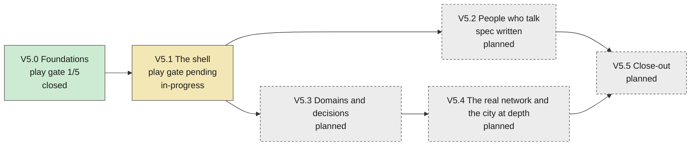
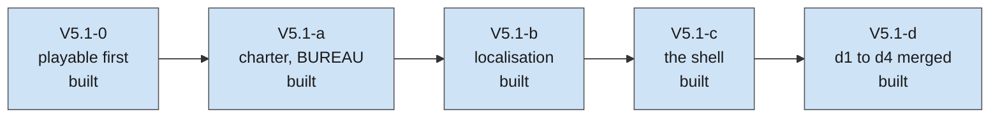

# V5 — The World Talks Back (SIGNED 2026-10-19)

> [!success] Signed by the author, 2026-10-19
> Asked "anything to add, or do you sign V5?", the author answered "je pense
> qu'on est bon" — signed, with every recommendation below taken the same day.
>
> Drafted 2026-10-19 by the V5 reflection session, in the same context as
> [[v5-reflection]] (whose three lists are this draft's evidence) and after a
> long interview with the author, whose asks and calls are that note's §0.
> Every row is still a hypothesis on [[v2]]'s rule: each
> block's plan gate re-counts against the tree, and **the plan gate is supreme
> over this doc when the two disagree** ([[v4]]'s rule, which survived real
> re-ordering).

The organising goal: **V1 built the machines, V2 made them visible and
located, V3 made Europe whole, V4 made the world want things — V5 makes it
talk to you, on real ground, through a screen worth looking at.**

Today nobody in this game speaks to the president. A hundred and two events
arrive in a narrator's voice; two scenes exist in the whole game; 2 147 people
want things and never say so. A decision is a percentage of GDP, never forty
lycées in Hauts-de-France. The roads are 640 straight lines between region
centres. And the author does not play it — "I do not consider it finished".

V5's test, in the author's chair after thirty minutes of play: **can the
player name someone who asked them for something, say what refusing cost,
point at something they built and where, and say what they do not know and
why.**

## Where V5 stands

Drawn from the block table below and the `state:` map in this page's frontmatter, and checked by `python tools/check_vault.py`: a block with no state, or a state for a block that does not exist, fails the check. Whoever closes a block updates its state here.

<!-- vault-diagram:roadmap begin (generated by tools/vault_diagrams.py --write; do not edit) -->

The sub-blocks that have a state of their own:

Each box says its state in words, so colour is never the only signal. `closed`: the play gate is scored and recorded. `built`: merged, not yet closed by a play gate. The states live in this page's frontmatter `state:` map and are updated by the session that closes a block; the diagram is generated from them and from the block table.
<!-- vault-diagram:roadmap end -->

## The evidence this tier is built on

From [[v5-reflection]], each finding turned into the step-0 gate of the block
that owns it. **Measured** 2026-10-18/19 on `main` at `ae427364` unless tagged.

| Finding | Number | Owning block |
|---|---|---|
| Save surface written three times; three registers still alias in `from_dict` | `nation_state.gd:1767/2048/2285`; `:2548/2555/2582` (paid by V5.0a: one table, `src/core/nation_fields.gd`) | V5.0 |
| Code never reviewed | 40 604 of 69 674 lines (58.3 %) last touched before 2026-09-01 | V5.0 |
| Files over the size rule | 73 of 208 by total lines; 23 by code lines; 3 past 2 000 total lines | V5.0 |
| Loader monolith | `data_loader.gd` 2 739 lines, 53 functions (paid by V5.0b: 447 lines, thirteen loaders) | V5.0 |
| Month tick | **446 ms** mean at 41 nations against a 300 ms band (re-run below; V4.11a recorded 392) — V5.0c: 316 ms mean, 383 ms worst; V5.0c2: 241 ms mean, 304 ms worst (medians of 3) | V5.0 |
| Agent gate as documented does not run | `suite_runner.py --ci` exits 2 without tests (paid by V5.0b: it runs the registry) | V5.0 |
| Shell monolith | `main.gd` 2 705 lines, 68 preloads, 133 commits | V5.1 |
| Strings | 0 `tr()` calls | V5.1 |
| Windows | 22, by system, behind 4 clusters | V5.1 |
| Budget panel forecast | ~4.5 s per refresh (**recorded**, [[someday]]) | V5.1 |
| Faces | 464 of 464 executives without a portrait; backdrops 432 × 632 | V5.2 |
| Scenes | 2 in the whole game | V5.2 |
| Projects | 5 programmes, one site each, no quantity, no AI use | V5.3 |
| Service quality | national only (`society.gd:51-55`) | V5.3 |
| Regimes | 4 templates, all democratic | V5.3 (the field), V6 (the machine) |
| AI budgets and unrest | never tick (`budget.gd:48`, `unrest.gd:120`) | V5.3 |
| Engine | 4.7.2 pinned and installed (V5.0a0, 2026-10-19); 4.8 in beta | V5.0 (4.7.2), between blocks (4.8) |
| Roads | 640 spines (623 land, 17 sea) over 277 regions | V5.4 |
| Relief and water | relief a baked picture the sim never reads; no river or lake drawn at depth | V5.4 |
| Firms sited to a city | 3 860 of 3 860 records | V5.4 |

**Re-run for this draft:** the suite and the tick probe — see "Measurements"
at the foot, recorded once.

## The calls the author made in the interview (2026-10-18/19)

Recorded in full in [[v5-reflection]] §0. The ones that shape the tier:

| Call | Answer |
|---|---|
| Order | **Audit → people who talk → transport**; war, army, espionage are V6 |
| Play gate | **Every block ends with thirty minutes of the author playing**; the verdict is a done-when |
| UI | **Football Manager 2024** as the reference; map visible, **left sidebar of domains, tabbed windows**, close cross back to the map; **no Continue** — real time and its speeds stay; **new charter** (fonts, palette) |
| Fog | Table precision **depends on the service that produces it**; the president **knows people unequally** and learns them; and fog is **shown, never silent** — a range, its source and why it is wide (the session's call 1, taken) |
| Art | **Photorealistic**, one shared grade |
| Language | **A language option** |
| Sound | **Voices, music, effects** — ElevenLabs Starter bought for the commercial licence |
| Decisions | **Sector allocations** in every domain tab; **general and sector law tiles**; **binary and graded** decisions; **where** to build |
| Transport | **Motorways and major roads, rail, main freight ports, airports**; **build lines**; **cross-border lines split by length, negotiable** |
| The Union | **Co-finances** infrastructure and sectors; laws can put the nation **outside EU law** |
| Likeness | **The portraits stay as they are, and nobody is excluded from affair or corruption content** — the author judges the final busts do not resemble their source photographs (2026-10-19). Voices are designed, never imitations |
| Corruption | **Pays in all four currencies**: the leader's personal wealth (overturning [[people-model]] §14.7's refusal), party and campaign money, diverted state budget, favours |
| Regime | Decree under an authoritarian regime; the president may **attempt** the tip when approval is extremely high and the other conditions allow (machine in V6) |

## The three calls I would take

Each with its alternative; the author signs or swaps.

1. **Fog is shown, never silent.** Every uncertain figure prints its range,
   its source and why it is wide; a hidden trait shows as unknown, not as a
   wrong value. The house rule "legibility wins" survives by making ignorance
   legible ([[v5-reflection]] T6). *Alternative:* Football Manager's masking,
   where values are hidden outright — more mystery, and the first thing a
   confused player blames. **Taken by the author, 2026-10-19.**
2. **Chance is seeded.** Every roll — a lever's success, a lie caught, a cost
   overrun — is a hash of the ids, the month and a salt, so identical states
   play identically and the 51-regime re-runs stay comparable (T7).
   *Alternative:* a true RNG seeded per save — simpler to write, and the
   balance harness loses its bit-identical baseline. **Taken by the author,
   2026-10-19.**
3. **Speech is templated on the want grammar.** About forty scene templates
   keyed on (kind, want family, trait); bespoke scenes only for the four
   playable nations' heads of state and government (the builder-check ruling
   below); every line through `tr()` from day one, English authored first and
   French in the same PR; voice for variable-free opening lines and key beats
   (T8). *Alternative:* bespoke scenes per person — richer, and unbounded at
   2 147 people in two languages. **Taken by the author, 2026-10-19.**

## Calls left for the author

On 2026-10-19 the author took **every recommendation this draft made**: the
three calls above, the tick band (**300 ms mean and 450 ms worst month, each
the median of three probe runs**, V5.0's gate), **AI nations' budget and
unrest tick** at V5.3c ([[v5-reflection]] D12, a re-baseline), and the
calendar booking composed laws at V5.2 ([[v5-reflection]] D15) — and, the
same day, **every [[someday]] disposition the session recommended**: reject
the faces the session flagged on the V4.3 wall and regenerate them in V5.2a;
re-tune the event book to the V1.8 standard (0 dominated pairs) and make
`events_probe`'s E2/E3 fail the run, in V5.2d; make divisions effects-aware
and add a true "protect industry" law, in V5.3b; leave the 25 generated
nations' majors to the generator. What stays open:

- ~~The network's data licence~~ — **delegated to the session by the author
  (2026-10-19, "do what is best"); the rule now standing for V5.4a's gate:**
  the least obligation that covers the need, chosen layer by layer on the
  gate's measured coverage. (1) **Public domain first** — Natural Earth
  roads, ports, airports, rivers and lakes need no attribution and no
  share-alike. (2) **Attribution-only next** — EuroGeographics EuroGlobalMap
  for rail and any layer Natural Earth leaves thin, once its licence text is
  read and confirmed to permit redistribution in a public repository with a
  credit line. (3) **OpenStreetMap last**, only for a layer neither covers:
  that file alone is published under ODbL 1.0 (`REUSE.toml` per file) with
  "© OpenStreetMap contributors" in the credits — the author accepts that
  share-alike as the fallback. No layer mixes sources inside one file, so
  every file carries exactly one licence.
- ~~The signature itself~~ — **signed 2026-10-19.**

## Rulings the builder check settled

An independent builder read this draft cold and returned eight questions. Two
were the author's — likeness and what corruption pays in, both answered on
2026-10-19 and recorded in the table above. The session settled the other
six itself, each overturnable at signing:

- **The play gate has a bar and an end.** The author records a score (1–5)
  and one sentence in the ledger. A verdict that names a defect breaking a
  playthrough earns **one** bounded fix pass (one session); everything else
  the verdict says is recorded and fed into the next block's plan gate. A
  block never stays open past that pass — the V4.4 lesson on loops without a
  stop rule.
- **V5.0's tick work may move numbers; nothing else in V5.0 may.**
  Byte-identity holds for the field table, the loader split and the review;
  the tick sub-block may change output only through a re-baseline predicted
  before it runs and accepted by the author, and may reach for a worker
  thread if the attribution says so. The band is re-checked at V5.2 and V5.3,
  where per-nation work grows.
- **Templates for every nation; bespoke scenes for the four playable
  nations' heads of state and government only.** DEU, FRA, GBR and POL are
  playable, and the project never assumes one player nation; cabinets and
  everyone else speak through templates. Spouses and the list of eligible
  presidents are authored for the four. The play gates are played as France;
  the probes cover all four.
- **No speech is generated while the game runs.** The game is offline: every
  voiced clip is generated in advance, which means voiced lines are written
  without variables (greetings, reactions, key beats), in both languages, on
  designed voices per archetype (kind × age × sex × language) rather than per
  person. Generation runs as a parallel content track from V5.1 on, so Starter's
  monthly credits spread over months; the volume is set at V5.2's plan gate
  from the measured credit allowance.
- **Everything the player reads is in French by V5's close.** Each block
  translates its own surfaces; V5.1b also translates the existing backlog
  (events, laws, people, firms — up to ~35 000 words by the builder's count,
  **inferred**, an upper bound). Translation runs on a glossary; the author
  spot-checks a sample per PR rather than every line, because the author's
  time is the bottleneck.
- **The calls have dates** — the list above.

## Block table

| # | Block | Track | Depends on | Estimate (sessions, **inferred**) |
|---|---|---|---|---|
| V5.0 | Foundations — the audit: one save field table, the loader split, the tick inside its band, a size ratchet, the pre-review hotspots reviewed | S + tools | — | 6–9 |
| V5.1 | The shell — the charter, localisation, the sidebar and domain windows, `main.gd` dissolved, the art grade | U + tools | V5.0 | 10–14 |
| V5.2 | People who talk — audiences, knowledge, influence, calls, corruption, affairs, the president's choice, voices | S + data + U + audio | V5.1 | 14–20 |
| V5.3 | Domains and decisions — sectors, the decision grammar, law tiles, the construction register, EU money and EU law, the tax tab | S + data + U | V5.1 | 14–21 |
| V5.4 | The real network and the city at depth — data gate, import, draw, travel times, build lines, cross-border negotiation | S + data + U + tools | V5.3 | 12–16 |
| V5.5 | Close-out — the tier playtest and the retrospective | — | all | 1–2 |

**Estimated 57–82 sessions** — V4's size (its re-count was 55–77), said once
here rather than discovered block by block.

### Execution order

**V5.0 → V5.1 → V5.2 → V5.3 → V5.4 → V5.5.** The author's order, with the
session's swap the author took: people before transport, because people
change how the game feels and transport mostly serves V6's war. V5.3 sits
before V5.4 because a TGV line is built through V5.3's construction register.
Each block runs in one child session with its sub-blocks inside it (the
version-session structure, `.superpowers/sdd/v5-version-session.md`); review
budget and severity bar fixed at the plan gate; the play gate closes it.

---

## V5.0 — Foundations: the audit

**Track S + tools.** Pays [[v5-reflection]] D1, D3, D4, D5, D6 and the docs
drift of §2.

*Objective.* Make the oldest, unreviewed code safe to build five blocks on,
**without moving a single number the game produces** — the tick sub-block
**c** excepted, under the builder-check ruling above (a re-baseline predicted
before it runs and accepted by the author).

*Sub-blocks (to confirm at the plan gate).* **a0** — the engine: 4.7.1 →
**4.7.2** (a maintenance release of 2026-08-18, "no known incompatibilities with
4.7.1"), pinned and proven the way AGENTS.md asks — the suite and the
byte-identical re-run before the bump is committed. **4.8** is in beta (beta 1,
2026-10-15, breaking changes in core, GDScript and input; stable announced for
Q4 2026): it gets its own gated PR between two blocks once it is stable, never
mid-block. *Built 2026-10-19: 4.7.2 installed, CI pin bumped, 51-regime re-run diffed against the 4.7.1 capture.* **a** — one field table drives
`duplicate_state`, `to_dict` and `from_dict`, each field carrying its default
and whether absence reads correctly; the three aliasing sites fixed; a
round-trip test over every field. *Built 2026-10-19: `src/core/nation_fields.gd`, 217 rows; every register rebuilt on load; golden dumps and the 51-regime re-run identical.* **b** — a loader per content type behind one
orchestrator; a size ratchet in CI on **code lines** (comments are the house
style, not a second job): a new file stays under 300, an existing one over it
may shrink and never grow, and no file stays past 2 000 total lines — the most
an agent reads in one call (`nation_state.gd` and `data_loader.gd` split here,
`main.gd` by V5.1's shell); AGENTS.md's agent-gate line corrected. *Built 2026-10-19: thirteen loaders in `src/core/loaders/`, `tools/check_size.py` in CI, `--isolate` runs; the loaded-content dump identical.* **c** — the
tick (*c0 built 2026-10-19: `tools/balance_parallel.py`, the 51-regime probe sharded, 37:06 → 7:19, its table `cmp`-identical to a serial run's; c built 2026-10-20: ten byte-identical levers, mean 424 → 316 ms and worst 558 → 383 ms, the worst band met and the mean missed by 16 ms; c2 built 2026-10-20, the author's A + B: three more byte-identical levers and Diplomacy's scoring on worker threads, mean 241 ms and worst 304 ms, both bands met, the table `cmp`-identical three times*)
attributed by `tools/tick_budget_probe.gd`, then Diplomacy's two
recomputations. **d** — review passes over the pre-review hotspots (size ×
churn × "a V5 block touches it"), at a budget fixed before pass 1. *Built 2026-10-20: the top eight reviewed once and the fix diff once; seven findings fixed byte-identical (three of them one Legislature/Referendum cluster, V5.3b's input), three recorded in [[someday]]; the table `cmp`-identical.*

*Done-when.* The 51-regime balance re-run is **byte-identical** before and
after (`tools/balance_probe.gd -- --json=PATH`, `tools/balance_diff.py`) — the
proof that an audit moved nothing; the suite green; the month inside the band
the author sets; the ratchet in CI; **the play gate**: the author plays the
current game for thirty minutes and records a baseline verdict every later
block is felt against.

*Gate.* Byte-identity is the gate for **a0**, **a**, **b** and **d**. A finding
there that would change a number is recorded, not fixed here, and becomes a
later block's input. **c** is judged on the tick band and its accepted
re-baseline.

## V5.1 — The shell

**Track U + tools.** Pays D2, D7, D14, D16.

*Objective.* A new charter and a new shell the rest of V5 lands in: the map
at the back, a sidebar of domains, tabbed windows over the map, a stack for
windows and scenes, every string translatable.

*Sub-blocks.* **0** — playable first, inserted ahead of the charter after
V5.0's 1/5 play gate (author, 2026-10-20): **0a** the month and the budget
without a freeze, **0b** the in-game dev console (added 2026-10-20), **0c** the
UI fixes the author hit, **0d** the embassies that already exist. *0a built 2026-10-21: every panel draws only while its window
shows; the month a cursor run across frames on the main thread, the clock held
and input deferred while it closes; the budget forecast a cursor run off the
frame. Month boundary 632–720 ms → 45 ms worst, lever drag ~10 s → 37 ms; the
table `cmp`-identical.* *0b built 2026-10-21: F12 opens a dev-only console
(debug build or `--dev-console`; nothing in a release build) with an error log
fed by Godot's Logger, a perf overlay (frame time, the month's cost per system)
and a command table (`help`, `get`, `set`, `skip`, `event`, `save`, `open`...)
whose every state change goes through `src/sim/dev_commands.gd`; agents reach
it through `run_command(text)` ([[tooling]]).* *0c built 2026-10-21: the OS window is resizable with a floor, a drag survives the menu and F11 flips fullscreen; the Agenda is no longer forfeited by one Space and says when the next programme opens; the portrait is one face with a mood icon; the legend's dev rows are gone; news of other countries is a switch, Off; the message column is an overlay. The minimap and category-click shifts did not reproduce and are c's.* *0d built 2026-10-21: the embassies that already exist are a directed register seeded from a rule `data/world/embassies.json` states (every roster state holds one in every other, except the pairs without relations), so none is offered where one stands; every capital resolves through one rule the map, the diary and the campaign share (G1); the runner fails a test on an ERROR line it did not declare (S7). Re-baseline: 0 flips, every run's vote shares moved by at most 0.0004 -- awaiting the author's acceptance.* **a** (*built 2026-10-21: the author picked BUREAU from the board; this block is its grammar -- tokens, Archivo, Material Symbols Rounded, the flag-colour accent by rule, the press grade, the theme test rewritten; the docked workspace is c's; see docs/history.md*) — the charter: a board of two or three directions
(fonts under OFL and committed, palette, iconography, the photographic grade,
and one **vector** icon family for the map, since ElevenLabs' image models
output raster only), mocked up before any code; the author picks one; tokens
into `ui_theme.gd`;
the grade applied across the portrait, scene and event-art libraries.
**b** — localisation: `tr()` across `src/ui`, keyed text in `data/`, string
tables EN and FR, a language option, containers sized to content (French runs
longer), and a test that fails on a hard-coded string in a panel. *b3 built
2026-10-21: every display of a data row goes through the `Strings` accessors (135
sinks), ids become words through `Labels`, a lint fails a raw row read, `--check`
fails a field nobody displays, and a French row of every kind is seen on screen.*
**c** — the
shell: the domain sidebar, the tabbed window, the screen stack with focus held
by the top window, the top bar, and the desk reworked into an inbox that can
carry requests and calls (the desk bound and the protected card column of
D16); `main.gd` below the ratchet. *c built 2026-10-22: the screen stack, the
docked workspace under a domain sidebar with back and forward, the title bar and
the figure strip that folds, text size 90-130 %, the inbox with its lanes that
slides over a tab for a holding decision, and the glossary tooltips' mechanism
(dashed terms in the inbox and the event text, a chain three deep with locks);
G2 and boot held; `main.gd` 2 124 lines, its total-lines exception still open
(the holds and desk cards move out in d); see docs/history.md.* **d** — the 22 windows re-homed as domain
tabs; the budget forecast's cost (D14) cut while it moves. *d2 built 2026-10-22: a frame for every staged state (`tools/screenshot_all.py`, 90 of 90), no map layer that reads by colour alone (a lightness rule over every data ramp), `main.gd` 1 919 total lines with no exception left, the G11 type scale, the keyboard path to a term, Revert's re-projection cut (D14's sim half to Systems); see docs/history.md.* *d3 built 2026-10-22: marks render in `PanelKit.line()`, and the A-Z Glossary tab; d4 (the country box) next; see docs/history.md.* *d4 built 2026-10-22: the country box (left click figures, right click verbs) and another nation's approval as a range and its source.*

*Done-when.* A windowed `tools/screenshot.gd` frame for every staged state; a
text-size option; no map layer that reads by colour alone; the UI chrome
complete in French; **the play gate**.

*Gate.* G2 (2.0 ms at max zoom) unchanged; boot time not worse; the panel
walker tests green.

## V5.2 — People who talk

**Track S + data + U + audio.** Pays D11 and the scenes gap.

*Objective.* People ask to see you, talk, bargain, lie and remember, and the
president knows some of them better than others.

*Sub-blocks.* **a** — the registers: knowledge, affinity, the relationship
(stranger, acquaintance, friend, close, rival, enemy, secret affair), social
skill (reading people, deceiving them), the spouse, the leader's personal
wealth; the president by default,
created, or picked among people eligible in the played nation; executives'
portraits and wide backdrops, in the same pass as the faces the author
rejected on the V4.3 wall (about eight unusable — corrupted, a sketch, wide
or group shots — and about fifteen streaked backgrounds, by eye; rejects
through `tools/curate_references.py --reject`). **b** — audiences: a request reaches the inbox;
book it (diary occupancy), delegate it or decline it; the scene as a window
over the map (the author's layout B) on `dialogue_manager`; branches; the
influence levers (argue, bargain, promise a date, pressure, flatter, appeal to
friendship) with odds from traits, knowledge and affinity, shown as ranges
when the president does not know the person; other topics (news of family,
an opinion, gossip about a third person, a dinner, flirting); phone calls,
lighter than an audience. **c** — the shadows: corruption offered and taken,
the affair and the spouse, lies and their detection, exposure through the
press and the courts; corruption paid in the four currencies the author
chose (personal wealth, party and campaign money, diverted budget,
favours). The author's likeness call rests on "the busts do not resemble
their photographs", so before c ships the four default leaders' busts are
put side by side with their source photographs and the author confirms it —
that call's evidence, recorded in the ledger. **d** — the voice:
templates EN and FR on the want grammar, events given speakers and re-tuned to
0 dominated pairs with `events_probe`'s E2/E3 wired to fail the run, designed
voices, music and effects through a `tools/` pipeline with each file's
provenance in `REUSE.toml`.

*Done-when.* Bands declared before the build and measured after: audiences
per term, lever success by knowledge band, the exposure rate of corruption
and affairs, no dominant lever; the save field table's absence column holds
("never met" reads correctly — no bump); **the play gate**.

*Gate.* The balance re-baseline predicted before it is run and accepted by
the author; G2 and the tick band held.

## V5.3 — Domains and decisions

**Track S + data + U.** Pays D8, D9, D12 and V5's half of D10.

*Objective.* Decisions in real units, in real regions, with an estimated
cost — and the Union paying for some of them and objecting to others.

*Sub-blocks.* **a** — sectors: `data/domains/` splits each spending line into
sectors with allocation shares; each sector moves a named quantity (a sector
that moves nothing is refused, measured); personnel derived; service quality
made regional. **b** — the decision grammar: binary, graded and quantified
decisions; the 120 laws tagged by sector; the general and sector tiles; the
decree route as a read of the regime field; the statistics service's quality
setting how precise every table is; divisions made **effects-aware** (the
author's call: forty lycées and four hundred must not divide alike —
`resolve_vote()` and its ~25 callers, measured by the legislature probe); a
true "protect industry" law beside the regulation that stands in for one;
and **polls on any measure** (the author, 2026-10-19): every tile — a law, a
tax change, a construction programme — can commission a poll on whether the
country likes it, per bloc. V4.2 already sells two polls on a named bill
from the briefing popup (a paid narrowing of the UI's blur, bought once and
fixed, never a reroll — `src/sim/statute.gd:419`); this widens the subject
from bills to measures and gives the poll the fog grammar: a price that buys
a smaller margin, a few weeks before the result reaches the inbox. And **the
address to the nation** (the author, 2026-10-19): on any pending law or
decision, the president can go on air to put pressure on parliament. It
costs a half-day of the diary; it moves the country's opinion of that measure
per bloc, by the president's social skill and standing and through the
outlets' leanings ([[media-model]]'s framing machine); and the deputies whose
voters moved feel it in the division — which needs the effects-aware
`resolve_vote()` above to read public opinion on the measure. Going public
can harden the other side, and each address in a short span is worth less
than the last, so it is a lever and not a button to press on every bill. The
scene uses the existing `tv_studio` and `podium_flags` backdrops and V5.2's
voice pipeline for its opening line.
**c** — the construction register: build or demolish N units of a type, in
one region, by hand, by need or by population; cost as a range set by the
ministry's competence; overruns; running costs and staff; used by the AI
nations, which gain their budget and unrest tick; the five programmes
re-expressed in it. **d** — the Union: EU programmes co-finance construction
and sectors through the existing transfer; a law flagged in data as
conflicting with a rule in force opens the real procedure (formal notice,
court, fines, frozen funds), and the player complies, pays or leaves.
**e** — the tax tab (the author, 2026-10-19): in the Economy domain, a tab that
**introduces, adjusts and abolishes taxes** — a wealth tax on the old ISF's
shape, production taxes, a sugar tax, and the rest of a catalogue in
`data/taxes/` — and shows **the estimated revenue gained or lost** beside every
change, as a range under the fog rule. Most of the machine exists: the five
authored taxes, brackets and progressivity ([[tax-model]]), and V4.2's
custom-tax register, whose params (base, erosion, birth rate) a catalogue
entry pre-authors so a real tax is chosen rather than invented; the Tax Code
panel already prints a born key's yield. What is new: the catalogue, each
entry's incidence (who pays — households, firms, consumers — and what else it
moves: sugar on health, production taxes on industry, carbon on emissions
through [[climate-model]]), abolition as a verb, and the estimate on every
row. **The route** (the author, 2026-10-19): a tax is **introduced or
abolished only in the autumn finance bill**, voted in the assembly — a budget
season once a year, with the 49.3-shaped forcing and its censure risk where
the template allows it; a **rate is adjusted once parliament approves it**
(the session's reading of the author's answer: an amending finance bill
during the year, applied after the vote — overturnable). Under an
authoritarian template both are decrees. Whether spending envelopes ride the
same bill is decided at V5.3's plan gate.

*Done-when.* Every sector moves a measured quantity; the cost estimate
brackets the realised cost in a declared share of probe runs; an address
moves a division by a declared band and never dominates (addressing every
bill loses to choosing); each tax's
revenue estimate brackets the realised yield over the next twelve months in a
declared share of runs; the AI uses the register at a declared rate; **the
play gate**.

*Gate.* The re-baseline predicted and accepted; the tick band held with AI
nations now ticking budgets.

## V5.4 — The real network and the city at depth

**Track S + data + U + tools.**

*Objective.* The roads, railways, ports, airports, rivers and lakes of the map
are real; relief costs something; a line can be built, across a border by
agreement; at depth a city shows what is in and around it.

*Today's ground (measured).* Relief exists **as a picture only**: V4.10a baked
a hillshade from ETOPO 2022 into the paper ground at depth
(`assets/map/ground_europe.json`), and nothing in the sim reads elevation.
**No river, lake or waterway is drawn** at depth (no match in `src/ui/map_*`
or the ground generator, which knows land and sea alone).

*Sub-blocks.* **a** — the step-0 gate: licence and coverage of the candidate
sources (EuroGeographics EuroGlobalMap; Natural Earth roads, ports and
airports, public domain; OpenStreetMap rail under ODbL), and the
**geometric routing** [[data-sources]] left unpriced: build a graph from the
linework and route between regions' principal cities; report the edges of 640
routed, the megabytes added and the G2 cost; and the water — Natural Earth's
rivers, lake centrelines and lakes (public domain) or the water theme of the
source that wins. **b** — import and draw: motorways, rail, ports, airports,
rivers, lakes and navigable waterways as projected mesh layers (V4.10c's
pattern), with a legend. **c** — the network in the sim: travel time by mode
(road, rail, high-speed rail, inland waterway) feeds the accessibility index
([[network-model]]), migration, and the president's travel days (today
great-circle at 280 km a day, [[calendar-model]] §12); **relief prices a
route** — slope and crossings raise a line's cost and build time (a tunnel
under the Alps is not a line across the Beauce); rivers carry freight and
are where the existing `river_flood` event and the flood-defence programme
are sited. **d** — building lines through V5.3's register along
a drawn route; a cross-border line's cost split by its length in each nation
and negotiated (offer, counter, the partner's answer from relations, budget
and its own regions' gain) — the project's first negotiation machine, which
V6's arms orders and the later resource deals reuse; EU co-financing for
cross-border links. **e** — the city at depth: its sited firms, plants, built
units, stations, ports and airports around the city's glyph, each opening its
record — **icons placed on the map itself**, not a separate screen (the
author's call, 2026-10-19). The map icons are **vector glyphs from V5.1's
charter**, tintable by sector, nation and state (planned, building, damaged)
and crisp at every zoom; generated raster art goes where it is seen large,
in the record a click opens (the session's recommendation, taken by the
author 2026-10-19).

*Done-when.* The share of the 640 edges routed on real linework; G2 ≤ 2.0 ms;
travel times sane against the real ones (a TGV Paris–Lyon near two hours);
**the play gate**.

*Gate.* The re-baseline predicted and accepted (accessibility moves growth
and migration).

## V5.5 — Close-out

The tier playtest, the merge record, promised against shipped, and the
retrospective, on [[v4]]'s close-out shape; the tier-end review PR built from
the `v4-end` tag.

---

## What V5 deliberately does not open

- **War**: armies on the map, military sites, arms orders, the arms embargo,
  annexation. **V6**, with its foundations laid here: the tick (V5.0), the
  field table (V5.0), the construction register (V5.3), the network, the
  relief and the rivers for supply and movement (V5.4), the negotiation
  machine (V5.4).
- **Espionage and what nations know of each other.** V6; V5's fog of people
  and statistics is its first half.
- **The authoritarian template and the attempt to tip.** V6, with army
  loyalty.
- **Resource deals, export controls, goods into GDP** ([[v5-reflection]]
  theme C, D13). V6 or V7.
- **A world roster** (China, Taiwan). After a tick that tiers nations by
  distance from the action.
- **Multiplayer, 3D, modding.**

## Measurements

Recorded once, here:

- **Suite:** `bash tools/run_tests.sh` on `ae427364` — **121 of 121 passed in
  11:57** (2026-10-18, run dir `reports/suite_runs/20261018-221421`,
  machine-local). One more than V4's close-out (120): PR #14's
  `tests/test_world_month.gd`.
- **Tick:** `tools/tick_budget_probe.gd`, 60 months on the live roster (41
  nations, 277 regions), run alone after the suite: **446 ms mean per month**
  against the 300 ms band (V4.11a recorded 392). The top four: Diplomacy 163
  (max 315), Economy 77, Migration 65, Commodities 47. Wall clock on one dev
  machine — read the ratios: **Diplomacy is 37 % of the month**, Migration a
  share no earlier record names.

## Sources

- Football Manager 2024's Continue button and sidebar: [afkgaming](https://afkgaming.com/gaming/general/how-to-simulate-seasons-and-matches-in-football-manager-2024),
  [fmscout (FM26's redesign, against FM24)](https://www.fmscout.com/a-fm26-reimagined-ui.html),
  [fmscout (inbox items that block)](https://www.fmscout.com/a-football-manager-2023-hints-and-tips.html).
- ElevenLabs commercial licence from Starter: [elevenlabs.io/pricing](https://elevenlabs.io/pricing);
  free-tier output stays non-commercial: [assetforgeindex](https://assetforgeindex.com/commercial-use/elevenlabs).
- EuroGlobalMap (EuroGeographics open data, transport theme, TEN-T fields):
  [EEA catalogue](https://sdi.eea.europa.eu/catalogue/srv/api/records/27812b75-404e-476e-8a21-07df0122d764?language=eng),
  [OSM wiki](https://wiki.openstreetmap.org/wiki/Eurographics_EuroGlobalMap);
  TENtec: [European Commission](https://transport.ec.europa.eu/transport-themes/infrastructure-and-investment/trans-european-transport-network-ten-t/tentec-information-system-and-ten-t-map-library_en).

---

Related: [[v5-reflection]] · [[v4]] · [[someday]] · [[panel-system]] ·
[[people-model]] · [[projects-model]] · [[network-model]] ·
[[map-platform-model]] · [[legislature-model]] · [[orgs-model]]
