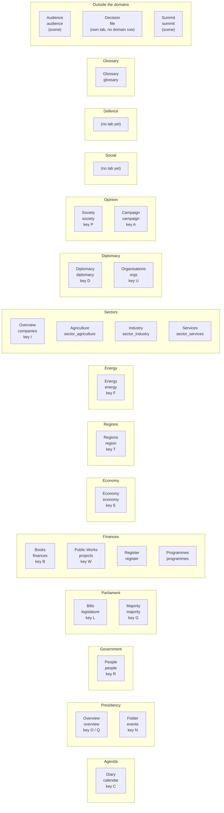

# The UI map

Where each screen lives, so nobody has to open `main.gd` to find out. **Generated by `python tools/ui_map.py --write` from the tracked files of `src/ui/`; never edited by hand** (CI runs `--check` and fails when it is stale). The shell it sits in is [[shell]]; the grammar of a panel is [[panel-system]].

## Domains and tabs

Sidebar domain -> tab -> window id (and its hotkey). A domain with no tab is hidden until a tab is registered under it.

## Every window

One row per `_windows.register()` call. *Opened by*: the sidebar (a domain's first tab) or the domain's tab strip, its hotkey, and the doors found in the code (`open("id")` / `open(CONST)` and kin, by file; a door built another way is not listed).

| domain | tab | window id | key | panel file | registered in | opened by |
|---|---|---|---|---|---|---|
| Agenda | Diary | `calendar` | C | `calendar_panel.gd` | `main.gd` | sidebar; key C; door in audience_driver, calendar_panel |
| Presidency | Overview | `overview` | O / Q | `presidency_page.gd` | `main.gd` | sidebar; key O / Q; door in briefing_driver, country_box, programme_file |
| Presidency | Folder | `events` | N | `events_panel.gd` | `main.gd` | tab strip; key N; door in briefing_driver, files_driver, programme_file |
| Government | People | `people` | R | `people_panel.gd` | `main.gd` | sidebar; key R; door in audience_driver |
| Parliament | Bills | `legislature` | L | `law_panel.gd` | `main.gd` | sidebar; key L; door in poll_card |
| Parliament | Majority | `majority` | G | `government_panel.gd` | `main.gd` | tab strip; key G |
| Finances | Books | `finances` | B | `finances_panel.gd` | `finances_driver.gd` | sidebar; key B |
| Finances | Public Works | `projects` | W | `projects_panel.gd` | `main.gd` | tab strip; key W; door in main |
| Finances | Register | `register` |  | `register_panel.gd` | `regions_shell.gd` | tab strip; door in regions_shell, register_warning |
| Finances | Programmes | `programmes` |  | `register_follow.gd` | `regions_shell.gd` | tab strip |
| Economy | Economy | `economy` | E | `economy_panel.gd` | `main.gd` | sidebar; key E |
| Regions | Regions | `region` | T | `regions_shell.gd` | `main.gd` | sidebar; key T; door in region_panel |
| Energy | Energy | `energy` | F | `energy_panel.gd` | `main.gd` | sidebar; key F; door in main |
| Sectors | Overview | `companies` | I | `companies_panel.gd` | `main.gd` | sidebar; key I; door in main, sectors_shell |
| Sectors | Agriculture | `sector_agriculture` |  | `sectors_shell.gd` | `main.gd` | tab strip |
| Sectors | Industry | `sector_industry` |  | `sectors_shell.gd` | `main.gd` | tab strip |
| Sectors | Services | `sector_services` |  | `sectors_shell.gd` | `main.gd` | tab strip |
| Diplomacy | Diplomacy | `diplomacy` | D | `nation_panel.gd` | `main.gd` | sidebar; key D; door in main |
| Diplomacy | Organisations | `orgs` | U | `orgs_panel.gd` | `main.gd` | tab strip; key U; door in council_cards |
| Opinion | Society | `society` | P | `polling_panel.gd` | `main.gd` | sidebar; key P |
| Opinion | Campaign | `campaign` | A | `campaign_panel.gd` | `main.gd` | tab strip; key A |
| Glossary | Glossary | `glossary` |  | `glossary_panel.gd` | `main.gd` | sidebar |
| (scene) | Audience | `audience` |  | `audience_scene.gd` | `audience_driver.gd` | door in audience_talks |
| (own tab, no domain row) | Decision | `file` |  | `decision_view.gd` | `files_driver.gd` | door in files_driver |
| (scene) | Summit | `summit` |  | `summit_panel.gd` | `main.gd` | door in main |

## Surfaces outside the domains

### The screen stack

`screen_stack.gd` ranks what owns the screen; Escape and the hotkeys follow the top. Lowest first.

| rank | name |
|---|---|
| -1 | `MAP` |
| 0 | `WORKSPACE` |
| 1 | `INBOX` |
| 2 | `PLACEMENT` |
| 3 | `SCENE` |
| 4 | `SYSTEM` |

Panels added to a rank (`<stack>.add(ScreenStack.RANK, panel, ...)`):

| rank | panel file | added in |
|---|---|---|
| `SCENE` | `briefing.gd` | `main.gd` |
| `SCENE` | `election_panel.gd` | `main.gd` |
| `SCENE` | `phone_dialog.gd` | `phone_driver.gd` |
| `SYSTEM` | `confirm_card.gd` | `confirm_card.gd` |
| `SYSTEM` | `pause_menu.gd` | `main.gd` |
| `SYSTEM` | `save_load_panel.gd` | `main.gd` |
| `SYSTEM` | `settings_panel.gd` | `main.gd` |

### The HUD's pieces

What `hud.gd` builds around the map (the inbox slides over the open tab; the sidebar is the domains above): `title_bar.gd`, `top_bar.gd`, `sidebar.gd`, `portrait_card.gd`, `clock_cluster.gd`, `inbox.gd`, `map_legend.gd`, `ribbon.gd`, `front_page.gd`, `chief_caption.gd`.

### Keys that are not a window's

The window hotkeys are in the table above.

| key | handled in |
|---|---|
| ESCAPE | `main.gd` |
| SPACE | `main.gd` |
| 1, 2, 3 | `main.gd` |
| M | `main.gd` |
| S | `main.gd` |
| ESCAPE | `country_box.gd` |
| ESCAPE | `glossary_tip.gd` |
| ESCAPE | `verb_plate.gd` |
| F1 | `glossary_tip.gd` |
| F11 | `window_mode.gd` |
| F12 | `dev_console.gd` |
| UP | `dev_console.gd` |

### Right-click

Files that handle `MOUSE_BUTTON_RIGHT`: `bill_actions.gd`, `country_box.gd`, `election_panel.gd`, `order_slot.gd`, `roster_line.gd`, `sector_panel.gd`.
